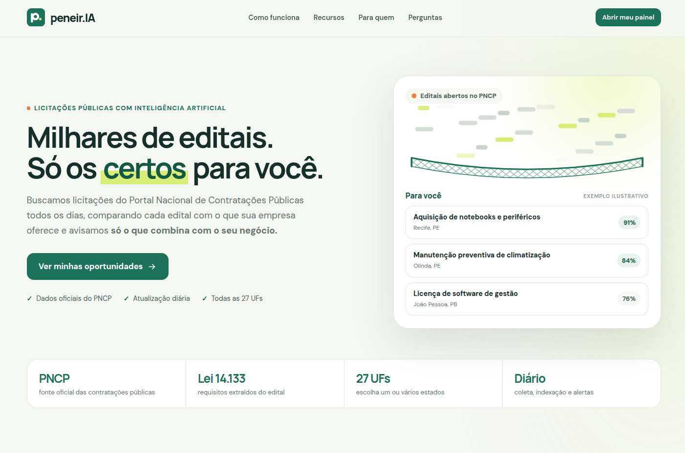
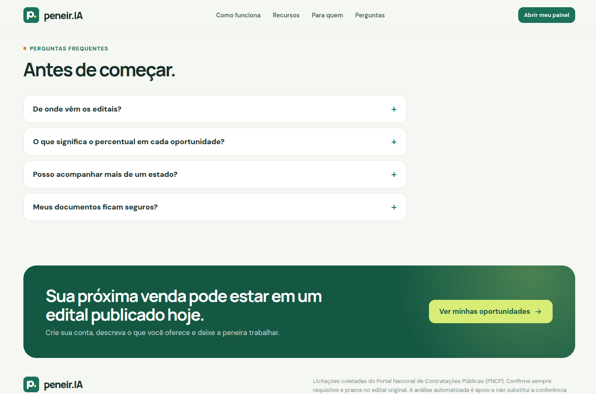
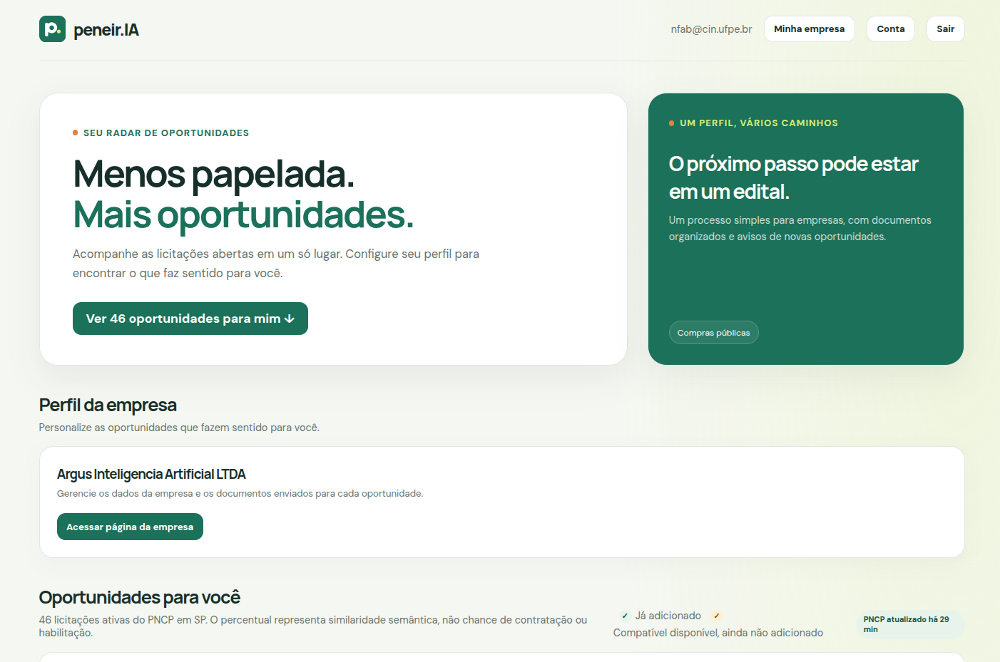
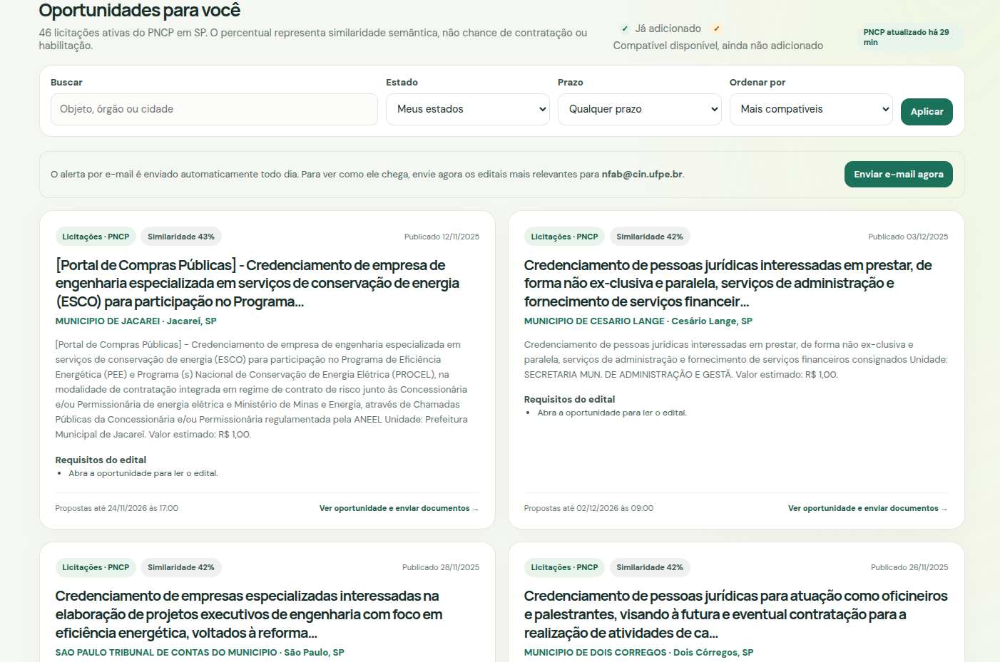
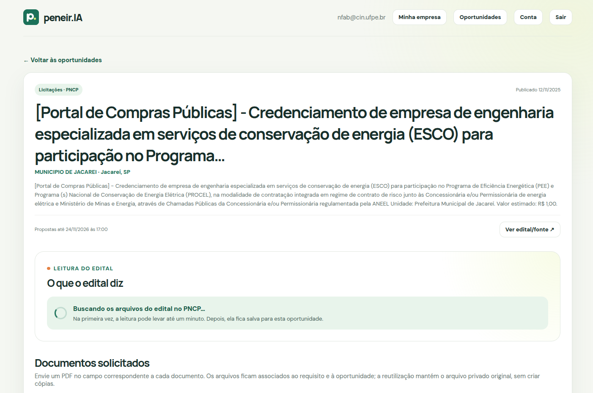
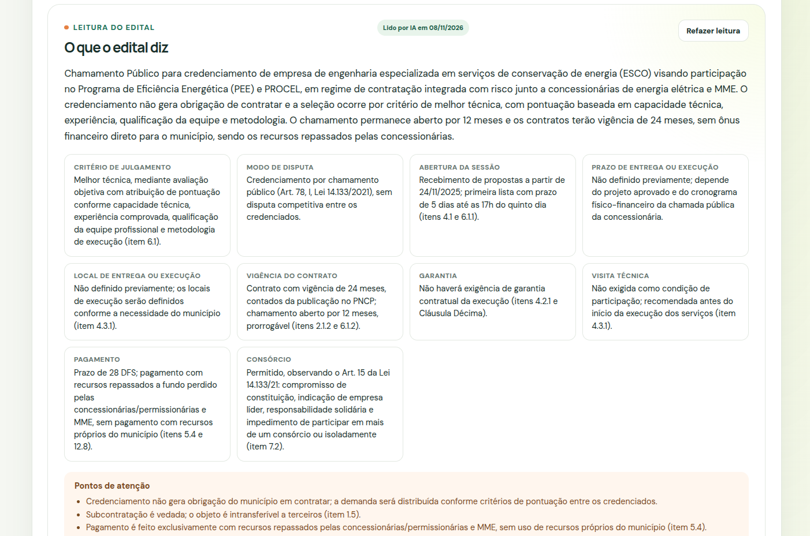
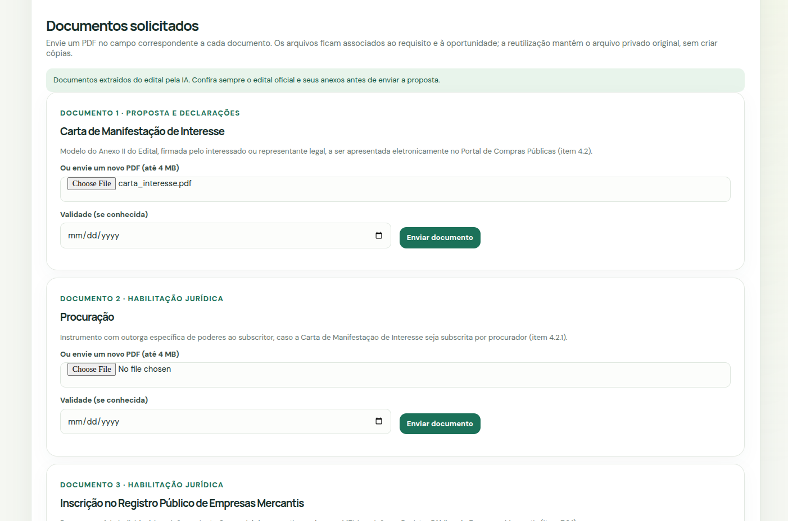
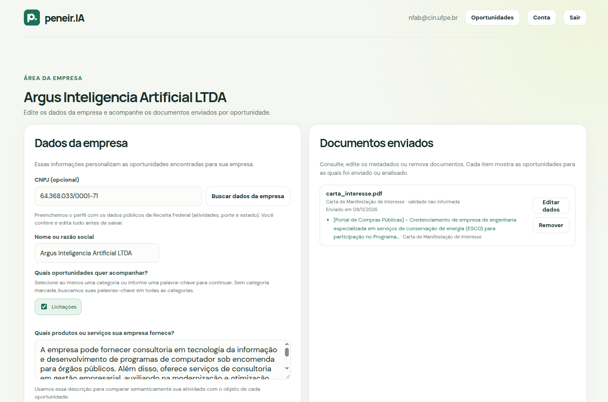

<!-- PROJECT LOGO -->
<br />
<p align="center">
  <a href="#sobre-o-projeto">
    
  </a>

  <h3 align="center">peneir.IA</h3>

  <p align="center">
    Um radar de licitações públicas para pequenas empresas: encontra os editais do PNCP que combinam com o seu negócio, lê o edital por você e mostra quais documentos você precisa ter em mãos.
    <br />
    <a href="#começando"><strong>Explore a documentação »</strong></a>
    <br />
  </p>
</p>

<p align="center">
  
  
  
  
  
</p>

<!-- TABLE OF CONTENTS -->
<details open="open">
  <summary><h2 style="display: inline-block">Índice</h2></summary>
  <ol>
    <li><a href="#equipe">Equipe</a></li>
    <li>
      <a href="#sobre-o-projeto">Sobre o projeto</a>
      <ul>
        <li><a href="#tecnologias">Tecnologias</a></li>
      </ul>
    </li>
    <li><a href="#funcionalidades">Funcionalidades</a></li>
    <li><a href="#a-ia-no-produto">A IA no produto</a></li>
    <li><a href="#começando">Começando</a></li>
    <li><a href="#screenshots">Screenshots</a></li>
  </ol>
</details>

## Equipe

<table width="100%" align="center">
  <tr>
    <td align="center"><a href="https://github.com/ThalesBezerra21"><br /><sub><b>Thales Bezerra</b></sub></a><br/></td>
    <td align="center"><a href="https://github.com/nathaliafab"><br /><sub><b>Nathalia Barbosa</b></sub></a><br/></td>
    <td align="center"><a href="https://github.com/kauagabr"><br /><sub><b>Kauã Gabriel</b></sub></a><br/></td>
    <td align="center"><a href="https://github.com/ligiaferro"><br /><sub><b>Ligia Ferro</b></sub></a><br/></td>
  </tr>
</table>

## Sobre o projeto

**peneir.IA** foi desenvolvido para o hackathon **Converge Challenge powered by Tako**. Ele ajuda micro, pequenas e médias empresas a participar de licitações públicas sem passar horas navegando em portais.

As compras públicas brasileiras publicam milhares de editais por dia no [PNCP](https://pncp.gov.br/) (Portal Nacional de Contratações Públicas). Para uma pequena empresa, três coisas travam a participação: **achar** o edital certo no meio de um volume enorme, **entender** o que ele exige (PDFs longos, muitas vezes dentro de ZIPs) e **manter a documentação de habilitação em dia**. O peneir.IA conecta essas três etapas em um só fluxo:

- **Perfil por CNPJ:** a empresa informa o CNPJ e o perfil é montado com os dados públicos da Receita Federal. A pessoa confere, edita e salva.
- **Busca semântica:** o perfil e cada licitação viram vetores, e o painel ordena os editais pela compatibilidade real com o que a empresa vende.
- **Leitura do edital por IA:** resumo, condições principais e a **lista de documentos exigidos**, extraídos dos arquivos oficiais.
- **Documentos e análise:** um arquivo de documentos da empresa, envio por requisito e análise assistida por IA, com evidências e avisos de validade.
- **Relatório de documentos por IA:** ao ler o edital, a IA compara todos os documentos do arquivo da empresa com cada exigência, diz se cada um se encaixa total ou parcialmente (ou não), explica o porquê e já vincula os que servem.
- **Alertas:** um e-mail diário com as oportunidades novas que combinam com o perfil e, ao fim de cada relatório, um e-mail com o resumo da vaga e o status dos documentos.

> O peneir.IA é uma ferramenta de apoio. Ele **não** declara habilitação, validade legal nem aprovação. O edital oficial sempre prevalece, e cada card tem link para a publicação original.

### Tecnologias

* [Next.js 15](https://nextjs.org/) e [React 19](https://react.dev/)
* [TypeScript](https://www.typescriptlang.org/)
* [Supabase](https://supabase.com/): autenticação, Postgres com segurança em nível de linha (RLS), armazenamento privado de arquivos e [pgvector](https://github.com/pgvector/pgvector)
* [LangChain](https://js.langchain.com/) (`@langchain/openai`): chains de geração de texto (leitura do edital, análise e relatório de documentos) sobre uma API compatível com OpenAI
* [OpenAI](https://platform.openai.com/docs): embeddings (vetores de texto)
* [Resend](https://resend.com/) para os alertas por e-mail
* [PNCP](https://pncp.gov.br/api/consulta/swagger-ui/index.html) e [BrasilAPI](https://brasilapi.com.br/) como fontes de dados
* [Vercel Cron](https://vercel.com/docs/cron-jobs) (tarefas agendadas) para a coleta e os alertas diários
* [Vitest](https://vitest.dev/) para testes

## Funcionalidades

| Área | O que existe hoje |
|---|---|
| **Cadastro e perfil** | Conta de empresa, **preenchimento do perfil por CNPJ** com edição manual, palavras-chave e **seleção de estados com atalhos** (todos, limpar, inverter e por região) |
| **Busca** | Similaridade semântica, busca por texto sem diferenciar acentos, filtros de estado e prazo, ordenação por compatibilidade, prazo ou publicação, e selo **Ótima match** acima de 80% |
| **Leitura do edital** | Leitura automática em segundo plano dos editais compatíveis, com resumo, condições (critério de julgamento, ME/EPP, garantia, visita técnica…), alertas e requisitos com o item do edital. Relê quando o PNCP publica arquivos novos |
| **Documentos** | **Arquivo da empresa**: envio de PDFs direto na página da empresa ou por requisito em cada vaga, e todo arquivo enviado fica disponível para todas as vagas. Sugestão de arquivos já enviados (sem vencidos), **vínculo automático pela IA**, edição e remoção |
| **Análise por IA** | **Relatório de documentos** (cada documento do arquivo × exigências do edital: encaixe total, parcial ou nenhum, com explicação), comparação documento × requisitos, extração e conferência de validade |
| **Alertas** | E-mail diário, envio imediato para demonstração, **relatório da vaga por e-mail** (resumo do edital e status dos documentos) e descadastro com um clique |
| **Privacidade (LGPD)** | Consentimento antes de enviar documentos à IA, exportação dos dados em JSON e exclusão da conta |

## A IA no produto

| Onde | O que a IA faz |
|---|---|
| **Embeddings (vetores)** | Transforma o perfil e cada licitação em vetores para a busca por similaridade |
| **Onboarding por CNPJ** | Reescreve as atividades (CNAE) da empresa como produtos e serviços fornecidos ao governo e sugere palavras-chave |
| **Leitura do edital** | Extrai resumo, condições, alertas e a lista de documentos exigidos a partir dos PDFs do PNCP |
| **Análise de documento** | Compara o texto de um documento com os requisitos do edital, com evidências e avisos de validade |
| **Relatório de documentos** | Lê todos os documentos do arquivo da empresa, indica o encaixe de cada um nas exigências do edital (total, parcial ou nenhum) com a explicação e vincula automaticamente os que servem |

## Começando

**Pré-requisitos:** Node.js 20.9+, um projeto no [Supabase](https://supabase.com/) e uma chave de API da OpenAI (ou de um provedor compatível com `/embeddings`). A conta no [Resend](https://resend.com/) é opcional e só serve para os e-mails.

1. Instale as dependências e copie o arquivo de exemplo de variáveis de ambiente:

   ```bash
   npm install
   cp .env.example .env.local
   ```

2. Preencha o `.env.local`. As variáveis essenciais são:

   | Variável | Para quê |
   |---|---|
   | `NEXT_PUBLIC_SUPABASE_URL`, `NEXT_PUBLIC_SUPABASE_PUBLISHABLE_KEY` | Conexão com o Supabase |
   | `SUPABASE_SERVICE_ROLE_KEY` | Chave secreta, só no servidor (crons e criação de contas) |
   | `DATABASE_URL` | URI Postgres do Supabase, usada para aplicar as migrações |
   | `OPENAI_API_KEY` | Busca semântica, leitura de edital e análise |
   | `NEXT_PUBLIC_APP_URL` | URL pública do app (`http://localhost:3000` em desenvolvimento) |
   | `RESEND_API_KEY`, `RESEND_FROM_EMAIL` | Alertas e relatórios por e-mail (opcional). O remetente precisa ser de um domínio verificado no Resend; para testar, `onboarding@resend.dev` entrega só para o e-mail dono da conta Resend |

   As demais variáveis (modelos, limites e UFs coletadas) têm padrões e estão comentadas no [.env.example](.env.example).

3. No Supabase, em **Authentication → URL Configuration**, defina a **Site URL** e inclua `http://localhost:3000/auth/callback` em **Redirect URLs**.

4. Inicie o servidor e abra [http://localhost:3000](http://localhost:3000):

   ```bash
   npm run dev
   ```

As migrações (`supabase/migrations`) são aplicadas automaticamente ao iniciar o servidor. Ao criar uma migração nova, reinicie o servidor. Para rodar os testes: `npm test`.

## Screenshots

| Página inicial | Perguntas frequentes |
|:--------------:|:--------------------:|
|  |  |
| **Painel: visão geral** | **Painel: oportunidades** |
|  |  |
| **Detalhe da oportunidade** | **Leitura do edital por IA** |
|  |  |
| **Documentos solicitados** | **Área da empresa: perfil por CNPJ** |
|  |  |

<p align="right"><a href="#top">voltar ao topo ↑</a></p>
